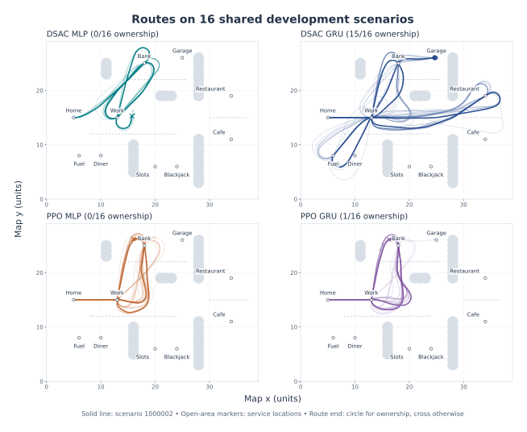

# Gambler’s Taxi


## The simulator

A JAX driving simulator for financial planning under travel costs, limited cash and deadlines. The driver chooses when to work, eat, sleep, refuel, borrow and gamble. A shared route controller takes those choices through a 2D city with physical steering, acceleration and collisions. To acquire the vehicle, the driver must survive, settle the car loan and all personal loans, then reach the garage.



## Read and inspect

| Open | Contents |
|---|---|
| [Assignment 1](reports/assignment1.md) | Environment design, reward and reflection |
| [Assignment 2](reports/assignment2.md) | Learning setup, compute and reflection |
| [Research report](reports/research.md) | Study question, evidence, transfer and limitations |
| [Study record](reports/study/README.md) | Technical notes, training history, results and raw-data links |
| [Media](media/README.md) | All replays, images and figures |
| [Reproduction](reports/study/reproduce.md) | Installation, replay, frozen checkpoint evaluation and figure generation |

DSAC GRU achieved **60/64 ownership completions** on the standard $500 development bank. The other three policies did not meet readiness. The 30-condition DSAC GRU evaluation recorded **239/256** standard test buyouts and **11/256** at $1,000 debt. [Development results](reports/study/results.md) and [final evaluation](reports/study/final_dsac_gru.md)

## Run a recorded episode

Clone or download the project and run from the root. On Linux or WSL with Python 3.13:

```bash
python -m venv .venv
source .venv/bin/activate
python -m pip install -r requirements.txt
python src/render_replay.py reports/study/data/replays/dsac_gru \
  --scenario-id 1000002 --output runs/dsac-gru-review.mp4 --stride 3
```

The [reproduction guide](reports/study/reproduce.md) gives GPU setup, all four checkpoint hashes and an exact development-bank command. Code follows the [IAEML course starter](https://github.com/InnoRL/IAEML-assignment).
