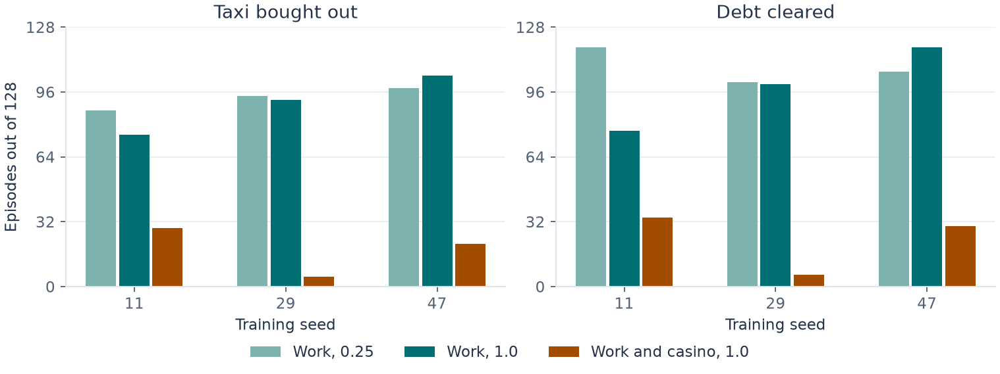
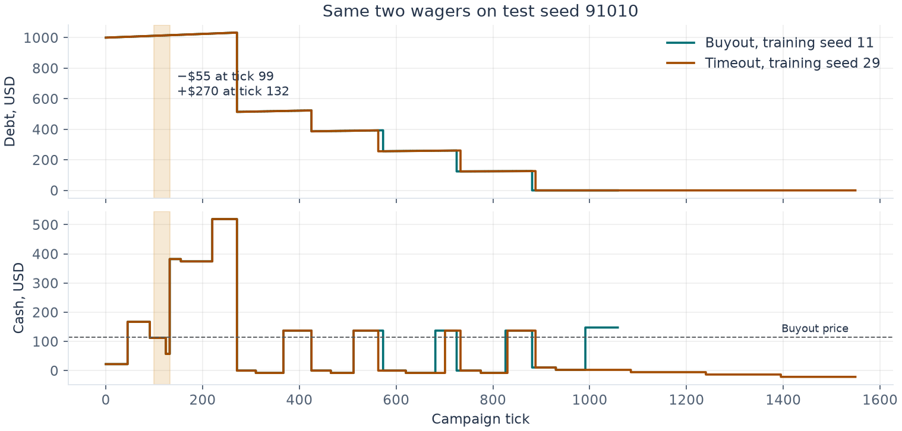

# Gambler’s Taxi: Diagnosing long-horizon risk in hybrid-action reinforcement learning

Iuliia Kurnaeva  
14 November 2026
Workshop research report

## Abstract

An agent that crashes before paying its debt can look indistinguishable on a leaderboard from an agent that survives and never chooses a viable route to the bank. Gambler’s Taxi makes those failures separately observable in a JAX driving task that couples vehicle control with work, sleep, gambling, and borrowing. In a ten-day campaign with $1,000 of opening debt, two archived Hybrid DSAC actors crashed on 128 of 128 held-out starts each. A look-ahead guard reduced crashes to 27 and 28 while leaving both actors at zero legal repayment opportunities and zero buyouts. With a shared driver, nine independently trained destination policies achieved 75–104 buyouts per 128 starts with work demonstrations and 5–29 with mixed demonstrations. The mixed policies occasionally finished earlier. In casino traces we observe voluntary repeat betting, but the direction of the loss effect at matched cash differs across three trained policies. The resulting artifact includes per-episode metrics, matched interventions, saved checkpoints, and replayable cases.

## 1. Motivation and contributions

A long-horizon task can conflate three questions. Can the agent execute the driving maneuver? Can it recognize when a trajectory should lead to work, sleep, the bank, or a gamble? What role does the environment itself play in the action that gets executed? The project began as an economic simulator and acquired physical routing to make each decision consume time and depend on safe execution. Early success on simple starts motivated a sequence of harder tasks, culminating in the opening debt campaign.

The contribution is a reproducible benchmark case and diagnostic protocol. A driving-only intervention keeps the actor fixed. A shared controller lets learned and scripted policies be compared on destination choice. A logged action override makes it possible to distinguish environment-induced and voluntary wagers. An outcome intervention restores cash to the same level after a win or loss and tests whether the policy responds differently at the next legal decision. These comparisons reveal information that terminal return and selected videos alone cannot provide.

## 2. Environment and agents

The car moves on a single 30 × 20 map with 16 lidar rays, fixed circular obstacles, and three moving vehicles. Continuous throttle and steering drive a kinematic bicycle model with drag and friction. Operations require parking at the appropriate destination, and movement, service times, wages, and casino availability share a clock. The ten-day campaign consists of 1,550 ticks. Opening debt is $1,000 and buyout costs $115. A completed shift pays $145, daily expenses cost $8, and interest accrues at 0.012% per tick. Credits add $60 to both cash and debt and raise anxiety. Full repayment at the bank gates garage buyout. Work and play are allowed at 100% fatigue. Fatigue instead increases the control cost through steering and braking dynamics.

A $55 slot wager has a 12% chance of returning $325. The expected net change is −$16, and an individual win nets $270. Blackjack costs $90 and uses explicit hit and stand decisions in the end-to-end actor. Both games share a 24-tick cooldown after settlement. The state updates habit, mood, tilt, and anxiety as games settle and as the agent works, rests, and pays its balance. Habit and urge can produce an optional environment override of a driving request into a legal wager.

The base objective combines +1 for buyout, −1 for collision, a bounded shortfall penalty at timeout, and a per-tick debt cost. The debt coefficient scales the clipped balance relative to opening debt and divides it by the horizon. Potential-based shaping combines net-worth progress and accessible route distances. It vanishes at terminal states and introduces no direct bonus for playing, borrowing, or visiting a building. Larger payouts still create short-term changes in available cash and can accelerate a successful episode. [Environment and derivation](assignment1.md) and [Potential-based shaping](https://aima.cs.berkeley.edu/~russell/papers/icml99-shaping.pdf)

| Policy | What it controls | Role in the study |
|---|---|---|
| End-to-end Hybrid DSAC | Gas, steering, and legal categorical operations at each tick | Archival learned policy and historical comparisons of risk objectives |
| Hybrid DSAC with a driving guard | The same actor and discrete decisions. A six-tick collision forecast may substitute a driving command. | Fixed-actor intervention on continuous execution |
| Destination PPO | One of nine destinations or operations every 12 ticks. A common controller drives and a fixed rule resolves hit/stand decisions. | Tests learned strategy with standardized execution |
| Scripted work and mixed drivers | Handwritten destination or operation choice under the same controller as PPO | Feasibility and behavior reference |

The Hybrid DSAC implementation uses two learned entropy temperatures and two 24-quantile critics. Earlier experiments compare a mean objective with a 35% lower-tail mixture. The final archived risk-seeking actor uses a 55% upper-tail mixture. Both tails contain 20% of the return distribution. The destination model has two 96-unit layers and outputs masked categorical scores and a state value. It uses clipped PPO with ratio limits of 0.8 and 1.2, GAE with `λ = 0.95`, and a small imitation term during PPO training. The 12-tick reward is the discounted sum of physical-step rewards, with the corresponding 12-tick discount for bootstrapping. The driving guard tests a nominal command and alternative braking or steering commands. Its short forecast can miss a longer route deadlock. [Hybrid implementation](../src/algorithms/hybrid_dsac.py), [PPO paper](https://arxiv.org/abs/1707.06347), [PPO implementation](../src/debt_learning.py) and [Shared driver](../src/debt_navigation.py)

## 3. Experiment sequence

| Stage | Comparison | What motivated the next stage |
|---|---|---|
| Early driving and work | Neutral vs. lower-tail Hybrid DSAC, 125 vs. 124 buyouts out of 128 | The early economy mostly rewarded work and sleep. |
| Mixed early and late starts | Initial neutral and lower-tail agents got 26 and 23 buyouts. With driving transfer and consistent demonstrations they reached 77 and 81. | Late starts still produced just 1 buyout out of 43 per learned policy after transfer. The scripted alternatives reached 7 and 8. |
| Eight-day economy | Neutral vs. lower-tail agents reached 87 vs. 103 buyouts out of 128, with 20 vs. 9 crashes. | Both worked and rested. The setting showed an association between the chosen risk objective and results at one training seed. |
| Mandatory settlement | Two learned actors achieved 76 and 74 buyouts out of 128, with zero after repayment. A scripted policy bought out after repayment in 12 cases. | The learned actors could finish when the bank was unnecessary. A long loan-to-repayment sequence remained hard. |
| Habit and enforced impulses | At 256 fresh starts per condition, the override produced 2 wagers for a learned actor and 20 for the scripted bank-and-casino driver. | The same-looking repeat bet can come from either policy choice or environment dynamics. |
| Opening debt and diagnostics | End-to-end Hybrid DSAC, driving-only intervention, three destination-policy training conditions, matched outcome and feature probes | Tests feasibility, decomposes failure, and measures voluntary continuation. |

Historical stages use different rules, schedules, and checkpoints. Their totals document development. Final comparisons within a fixed environment have separate seed banks and denominators. [Historical design, results, and checkpoints](assignment2.md)

## 4. Final evaluation protocol

The held-out evaluation includes 128 starts per condition, seeds 91000–91127. Eighteen conditions are recorded: four archived actor evaluations with and without driving guards, two scripted controls, nine selected PPO policies, and three mixed imitation-only controls. The initial conditions align across variants. Dynamics and randomness after reset can diverge, especially across architectures. Two additional Hybrid DSAC training runs use seeds 29 and 47 and are evaluated with the original seed-20000 test bank so they can be compared with the archived seed-11 experiment.

The destination-policy design has three arms. Work demonstrations are tested with debt coefficients 0.25 and 1.0. Mixed work and casino demonstrations are tested with 1.0. Each arm uses training seeds 11, 29, and 47 and the same compute budget. The setup uses 48 demonstration starts, 1,200 imitation updates, 50 PPO iterations, 64 parallel environments, and 24 destination decisions per iteration. That is 76,800 decisions and 921,600 physical-step slots, including padding after terminal states within a decision window. Demonstrations use seeds 45000–45047. Validation uses 81000–81047. The chosen checkpoint maximizes buyouts, then debt clearance, then minimizes crashes and remaining debt.

Each final rollout records cash, debt, action eligibility, requested and executed actions, counters, and terminal status. A buyout is valid only after full repayment. Time-to-event comparisons that include all starts replace an unreached event with the deadline tick 1550. This avoids presenting the rare fastest successful runs as typical. Fixed-actor intervention results and the three independent training seeds are reported separately. [Configuration, hashes, and per-condition metrics](../artifacts/debt_research/results.json)

## 5. Results

### 5.1 Crash prevention leaves a financial failure

On the new 128 starts, the neutral and upper-tail Hybrid DSAC actors each reached at least one completed shift on every episode. Their median number of completed shifts was one. The look-ahead guard reduced crashes from 128 to 27 for the neutral actor and 128 to 28 for the upper-tail actor. Each still reached zero states with a legal payment and completed zero buyouts. On the original test bank, the upper-tail training runs at seeds 11, 29, and 47 also achieved zero clearances and zero buyouts. Their crash counts were 128, 122, and 101. [Original upper-tail evaluation](../artifacts/debt_upside_evaluation.json), [Seed 29](../artifacts/debt_research/hybrid_seed_29/evaluation.json) and [Seed 47](../artifacts/debt_research/hybrid_seed_47/evaluation.json)

In 256 controlled bank states where a loan and a repayment are both legal, the original upper-tail actor assigns mean probabilities of 97.4% to a new loan and 1.1% to repayment. Increasing cash by $200 shifts these to 95.9% and 1.6%. The same actor can respond to other state variables. In home states, changing fatigue from 15% to 95% raises mean sleep probability from 22.4% to 90.3%. For the PPO with 104 buyouts, adding $200 at home raises the mean probability of targeting the bank for repayment from 16.5% to 51.2%. These probes measure the effect of a constructed input change on model output. The rollouts identify which decisions the policy actually had a chance to make. [Decision probes](../artifacts/debt_research/decision_probes.json)

### 5.2 Work makes success repeatable, while risk sometimes advances it

| Demonstrations | Debt coefficient | Training seed | Buyouts | Debt cleared | Crashes | Buyouts after gambling | Mean buyout tick including failures |
|---|---:|---:|---:|---:|---:|---:|---:|
| Scripted work | 0.65 | — | 64 | 125 | 5 | 0 | 1473.2 |
| Scripted mixed | 0.65 | — | 3 | 4 | 37 | 3 | 1539.0 |
| Work | 0.25 | 11 | 87 | 118 | 1 | 0 | 1460.7 |
| Work | 0.25 | 29 | 94 | 101 | 20 | 0 | 1463.2 |
| Work | 0.25 | 47 | 98 | 106 | 28 | 0 | 1466.6 |
| Work | 1.0 | 11 | 75 | 77 | 2 | 0 | 1462.2 |
| Work | 1.0 | 29 | 92 | 100 | 25 | 0 | 1474.2 |
| Work | 1.0 | 47 | 104 | 118 | 13 | 0 | 1456.2 |
| Mixed | 1.0 | 11 | 29 | 34 | 27 | 23 | 1486.9 |
| Mixed | 1.0 | 29 | 5 | 6 | 3 | 5 | 1538.5 |
| Mixed | 1.0 | 47 | 21 | 30 | 39 | 18 | 1538.9 |

All counts are out of 128. Each of the three mixed imitation-only controls recorded 0 buyouts. With work demonstrations, increasing the debt coefficient from 0.25 to 1.0 changes buyouts by −12, −2, and +6. Mean debt-free tick with failures assigned to the horizon goes from 1322.3 to 1330.8 averaged across the three seeds. A stronger time penalty alone does not reliably improve early repayment. All nine selected PPO policies took zero new loans on this test. The mixed policies initiated slot wagers. Blackjack appears in the scripted and end-to-end comparisons.



*Figure 1. Final outcomes on 128 common starts per policy. Color identifies the demonstrations and the debt-cost coefficient. Each group represents an independently initialized run.* [Source table](../artifacts/debt_research/results.json)

Matching the test starts between the work and mixed policies at coefficient 1.0 gives 21, 2, and 19 starts where both bought out for training seeds 11, 29, and 47. The mixed policy finished earlier in 15, 2, and 4 of those cases. It was the only policy to finish in another 8, 3, and 2 cases. The comparison conditions on the tested pairs and uses realized episode randomness.  In the full sample each work policy had the better deadline-adjusted mean buyout tick. [Per-start results](../artifacts/debt_research/results.json)

### 5.3 Voluntary continuation and loss-specific response

We deactivate only the automatic action override in the final evaluation. A repeat is voluntary if the policy requests a legal deal or spin and the environment executes it. For each resolved round we look for the first legal next-bet opportunity and for any voluntary repeat within 155 ticks. Counts include resolved rounds with no new opportunity. A driver can leave, lose stake liquidity, encounter closing time, or crash, so exposure differs after wins and losses.

| Actor | After losses: first bets / opportunities / resolved rounds | After wins: first bets / opportunities / resolved rounds | Matched loss minus win |
|---|---:|---:|---:|
| Archived neutral Hybrid DSAC | 70 / 70 / 160 | 19 / 19 / 29 | +0.004 pp |
| Archived upper-tail Hybrid DSAC | 98 / 98 / 159 | 36 / 36 / 61 | +0.004 pp |
| Mixed PPO, seed 11 | 32 / 32 / 101 | 0 / 0 / 22 | −2.90 pp |
| Mixed PPO, seed 29 | 101 / 101 / 204 | 0 / 0 / 24 | +0.26 pp |
| Mixed PPO, seed 47 | 0 / 0 / 78 | 0 / 0 / 15 | −0.24 pp |

For the matched comparison, 256 synthetic pending slot states use the same state and key to generate either a win or a loss through the environment. After the usual cooldown the probe aligns cash before scoring the next wager. Place, time, remaining debt, fatigue, and legal eligibility align. Mood, tilt, anxiety, and habit can differ due to the modeled outcome. For mixed seed 29, the next-slot probability is 26.26% after a loss and 26.01% after a cash-matched win. The paired 95% bootstrap interval of the difference is +0.14 to +0.37 percentage points. With the actual payout still in cash, the win probability of choosing slots drops to 8.83%. The interval describes variability over probe states for a fixed actor. It gives no estimate of between-training robustness, and the other mixed seeds favor the win condition.

Feature interventions on the same seed-29 actor after a loss change slot probability by −12.13 pp for +20 pp fatigue, −6.13 pp for +$100 cash, and −5.15 pp for −$250 debt. Replacing habit or mood with the matched-win value gives −2.35 pp and +2.37 pp, respectively. These perturbations have different units and magnitudes. They establish local sensitivity to the chosen inputs and a useful baseline for interpreting economic versus outcome cues. [Probe pairs](../artifacts/debt_research/mixed_demos_urgency_1_seed_29_probes.npz) and [All probe summaries](../artifacts/debt_research/results.json)

### 5.4 Two identical bets with opposite outcomes

On shared start 91010, both mixed agents lost $55 at tick 99, voluntarily bet again at tick 123, and made $270 at tick 132. Seed 11 cleared the debt at 881 and bought out at 1059. Seed 29 cleared it at 888 with $10.56 in cash. The car stopped moving at 919 near the bank, missed shifts, and lost its job at 1154. For the last 300 ticks the high-level policy kept requesting the trip home. The car remained stationary and no sleep action began. Daily charges left −$29.44 at timeout. The trace shows a successful financial milestone followed by a routing failure under the shared driver. [Buyout trace](../artifacts/debt_research/cases/mixed_demos_urgency_1_seed_11_first_win_91010.npz) and [Timeout trace](../artifacts/debt_research/cases/mixed_demos_urgency_1_seed_29_work_sleep_and_repeat_91010.npz)



*Figure 2. Both trajectories share the highlighted gamble outcomes. Traces show pre-action balances. The horizontal reference is the $115 price after debt clearance.*

A second mixed run, seed 91038, lost $55, bet again, and won $270. It completed seven shifts and two sleeps, reached 100% fatigue, cleared its debt at 1192 and bought out at 1340 with $3.77 left. The scripted two-venue control also produced a buyout at tick 854 following two slot jackpots, one blackjack loss and one blackjack win. It succeeded on 3 of 128 starts. The archived end-to-end actor visited both casinos on seed 91003 and crashed at tick 503 after two shifts and one sleep. [Learned risky buyout](../artifacts/debt_research/cases/seed_91038.mp4), [Two-venue scripted success](../artifacts/debt_research/cases/scripted_mixed_win_work_sleep_and_repeat_91079.npz) and [Two-venue learned failure](../artifacts/debt_research/cases/legacy_upside_history_with_both_games_91003.npz)

## 6. Related work, practical use, and limitations

Hybrid SAC supplies a design for joint continuous and discrete control. DSAC supplies distributional action values for risk-sensitive objectives. The 12-tick controller follows the general idea of temporal abstraction. The project uses established algorithms to study where a compound task fails and how to instrument it. Safety-Gymnasium evaluates objective completion and safety across tasks. MetaDrive tests generalization across diverse driving scenarios. Gambler’s Taxi provides a small, auditable case where cash, debt, schedule, and physical access determine which operations a driver can complete. [Hybrid SAC](https://arxiv.org/abs/1912.11077), [DSAC](https://arxiv.org/abs/2004.14547), [Temporal abstraction](https://people.cs.umass.edu/~barto/courses/cs687/Sutton-Precup-Singh-AIJ99.pdf), [Safety-Gymnasium](https://arxiv.org/abs/2310.12567) and [MetaDrive](https://arxiv.org/abs/2109.12674)

Prior observational work measures continuation, stake changes, and time between wagers as distinct signals. Our simulator can hold cash constant and intervene on outcome-dependent state updates. In this setting the strongest conclusion is voluntary persistence, with weak or opposite evidence for a loss-specific response across training seeds. No human data or clinical validation is included. The policy input probes describe action sensitivity under the specified model. [Chen et al., 2022](https://journals.plos.org/plosone/article?id=10.1371/journal.pone.0273359)

Practical uses include regression testing a robot or game agent that has to complete several services safely under a deadline, auditing whether a safety intervention causes stalling, and stress-testing which reward weights actually improve completion or early repayment. In games or teaching, the environment lets a reader inspect whether observed behavior comes from the policy, the payoff distribution, or a rule in the simulator. Applying the protocol to real transport or human decisions would require domain data, different dynamics, and independent validation.

The evidence covers one map and a small number of training seeds. The Hybrid DSAC and PPO interfaces, observations, and control responsibilities differ. Their comparison supports a feasibility result under shared navigation. Additional maps, a crossed baseline with identical observations and controller, more training seeds, and held-out starting-debt and schedule ranges would test for an algorithm-level advantage and isolate mechanisms. A learned demonstration of the full new-loan-to-buyout cycle remains open in the final campaign. Experiments on loss-specific betting need broader support across seeds and opportunity conditions. [Agarwal et al., 2021](https://proceedings.neurips.cc/paper/2021/hash/f514cec81cb148559cf475e7426eed5e-Abstract.html)

## 7. Reproduction and artifact map

Training uses JAX 0.12.0.1 and Optax 0.2.9 on an NVIDIA RTX 3080 Ti Laptop GPU under Ubuntu WSL2. The saved evaluation used NumPy 2.5.4. The `results.json` protocol records source hashes, checkpoint hashes, model configurations, and the test and probe banks. `*_episodes.json` records individual results, `*_probes.npz` records matched observations at the level of actor output, and `cases/` contains switched-action and route traces. `validation.json`, `selected.npz`, and `last.npz` are saved per PPO run. The artifacts also contain the three original mixed imitation snapshots. New training saves imitation snapshots for all arms.

From the project root, use the CUDA environment described in the README. These commands train all nine destination policies, run their held-out evaluation, and run the controlled decision probes. The README also covers evaluation of the archived end-to-end actors, new Hybrid DSAC training, and figure and video reproduction.

```bash
python src/debt_learning.py --output runs/debt-retrained/models --iterations 50
python src/debt_learning.py --output runs/debt-retrained/models --iterations 50 --urgency 1 --expert mixed
python src/debt_research.py --output runs/debt-retrained --destination-only
python src/debt_decisions.py --output runs/debt-retrained
```

A fresh repeat of training seed 29 at coefficient 0.25 reproduced every array in the selected and final checkpoints and the validation history exactly on the same software and GPU. The two archives have different metadata because the later writer includes the demonstration source. A subsequent validation of the README evaluation commands reproduced the outcome and repeat-bet summaries for all 14 destination conditions. The four archived continuous-policy configurations shifted in their exact crash or wager counts across fresh GPU runs. All four still yielded zero buyouts and repayments, and the guard consistently reduced crashes. The result tables above refer to the saved evaluation. Historical videos can be regenerated from saved logs, while exact retraining of earlier economic versions needs the corresponding source revision. [Repeat check](../artifacts/debt_research/repeat_check.json) and [Training, evaluation, rendering, and figure commands](../readme.md)

| Artifact | Use |
|---|---|
| [Main evaluation](../artifacts/debt_research/results.json) | Aggregates, exact policy settings, hashes, test and probe seed banks, and representative case IDs |
| [PPO checkpoint directories](../artifacts/debt_research/models/) | Selected and final weights for all nine runs, validation histories, and mixed imitation controls |
| [Per-episode example](../artifacts/debt_research/mixed_demos_urgency_1_seed_29_episodes.json) | Individual outcomes, financial milestones, round eligibility, and voluntary repeat bets |
| [Decision probes](../artifacts/debt_research/decision_probes.json) | Mean softmax probabilities and modal counts after changes to state inputs |
| [Plot script](plot_research.py) | Regenerates both figures from recorded metrics and logs |
