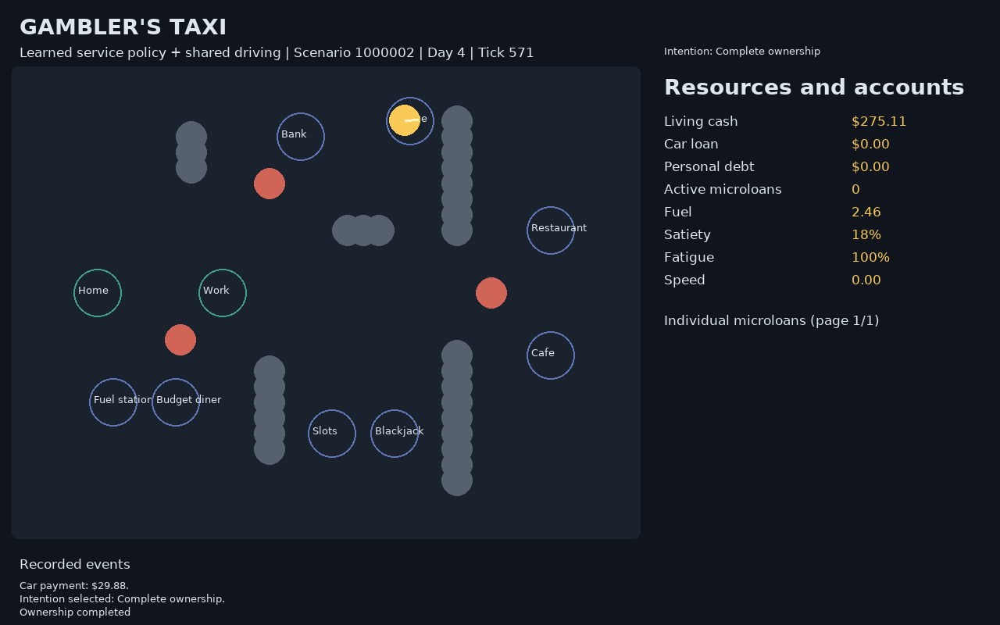

# Assignment 2: Reinforcement learning

Iuliia Kurnaeva  
23 November 2026

## Research question and experimental setup

The prototype established that a learned policy could sometimes wager again after a loss and still complete a debt campaign. Two early policies on the same initial scenario each lost $55, repeated the bet and won $270. One reached the garage. The other cleared its debt and then stalled on the trip home. I carried two lessons into the redesigned experiment. A financial milestone was insufficient to establish task completion, and the earlier results depended on the environment and training setup. Some destination policies had received demonstrations, and the prototype had no starvation terminal. I used the redesigned environment to ask whether a policy could learn to coordinate economic decisions directly from experience. [Early experiments](../baseline/reports/debt_research.md), [training diagnosis](training_diagnosis.md) and [experiment history](study/experiments.md)

The actor chooses a discrete service and a bounded continuous driving style. A shared controller applies acceleration and steering to reach the selected service, so every policy pays the resulting travel and resource costs. The learners discount future rewards by the actual elapsed physical ticks between decisions. I compared hybrid distributional SAC (DSAC) and PPO, each with a feedforward MLP and a GRU. DSAC reuses transitions from replay and learns two quantile critics. PPO uses fresh rollouts, clipped likelihood ratios and generalized advantage estimation. The four configurations used one initialization each, a common 14-lesson schedule up to $500 in car debt and the same decision ceiling. Lesson caps led to different amounts of realized experience. Final scenario IDs were separate from training and checkpoint selection. [Training settings](study/training.md), [model architectures](../media/figures/agent_architectures.svg) and [training logs](study/data/cohort/)

I compiled the simulator and learner updates in JAX, batched 64 environments with `vmap` and used `lax.scan` for repeated steps. The simulator reuses precomputed road-distance arrays. Rendering is offline, so training and evaluation write numeric trajectories with requested actions, applied controls and resource balances. The same records support replay audits and videos. [Training pipeline](../media/figures/training_pipeline.svg) and [reproduction guide](study/reproduce.md)

## Diagnosing the failures

In the first 18 completed model runs of an earlier study, none of 4,608 standard episodes reached ownership. There were 4,155 starvation deaths and 453 collisions. The food-trip checks identified one execution problem: the 32-tick decision could expire before the driver received a meal. I extended service decisions and exposed the menu, then used the action traces to distinguish execution failures from cases where the policy rarely chose food at all. [Early diagnosis](training_diagnosis.md), [food-trip tests](../experiments/food_execution_diagnosis.json) and [problems and fixes](study/problems_and_fixes.md#learning-and-evaluation)

The two PPO policies showed a failure of transfer. At their final failed checkpoints, each still completed 16/16 episodes on the same isolated food-approach test. In the full campaign they completed zero and one meals, respectively, across 64 standard development episodes each. One PPO MLP trajectory shows the sequence: two payments each reduced its cash to zero, then it set off for another shift with little satiety remaining. The checkpoints had retained the local food interaction. The full campaign required scheduling it before time or cash ran out. [Per-decision diagnosis](resource_study_review_2026-11-23/food_diagnosis/findings.md) and [checkpoint comparison](study/transfer.md)

For DSAC MLP, a separate diagnostic exposed disagreement between the actor and critic. The critic ranked the restaurant first in all 16 saved hunger states, while the actor assigned it probability about 8 × 10⁻¹⁰. A forward-KL update strengthened the gradient for that action and recovered 16/16 in the local restaurant test. The standard campaign still ended at 0/16. The same trial completed 93 meals but no refuels, and 13 episodes ended with an empty tank. Other diagnostics found repeated one-tick refusals at work and a gap between externally explored actions and the saved PPO policy. Longer refusal feedback and native-policy exploration passed targeted checks. The short full-game PPO trials still ended at 0/16. [Actor–critic probe](local_food_recovery/ACTOR_DIAGNOSIS.md), [PPO exploration diagnosis](local_food_recovery/PPO_DIAGNOSIS.md) and [recovery trials](study/results.md#recovery-and-integration-results)

## Results and limitations

Only DSAC GRU qualified for final evaluation. It reached ownership in 60/64 standard development episodes, compared with 8/64 for PPO MLP, 3/64 for PPO GRU and 0/64 for DSAC MLP. I evaluated the saved DSAC GRU on all 30 registered conditions. It reached ownership in 239/256 standard test episodes and 11/256 at $1,000 in car debt. None of the 7,680 episodes contained a wager request. All 11 high-debt buyouts came from wages and starting cash. In one case, five shifts paid $236.25 each, enough to cover food, fuel, interest and late fees before ownership on day eight. The final suite describes how this checkpoint responds to changing conditions. One initialization per architecture and unequal realized training budgets leave the effect of recurrence unresolved. [Development results](study/results.md), [final evaluation](study/final_dsac_gru.md) and [$1,000 transaction ledgers](study/data/final_dsac_gru/s28_buyouts.csv)

## Future work

I would first test whether stricter gates improve transfer. An intermediate gate could advance at 4/16, and the earlier selection code could export a different checkpoint from the one that passed. I would require the same exported policy to complete meals from several starting locations and pass an independent full-campaign check. Repeating earlier probes at later checkpoints would show whether a failure reflects lost performance on the same inputs or difficulty using the skill in a new setting. The new gate logic has passed local verification. Its effect on training remains an experimental question. [Recovery protocol](resource_study_review_2026-11-23/recovery_status.md) and [checkpoint selection diagnosis](local_food_recovery/PIPELINE_REVIEW.md)

I would then vary one part of training at a time. For DSAC MLP I would start from matched checkpoints and replay settings, vary the actor loss, and measure both meal and refuel completion. For PPO I would compare exploration schemes and inspect the advantages attached to completed meals in the full campaign. Repeating these comparisons across seeds with matched budgets would test whether the findings hold across training runs. An investigation of repeat wagering would need a policy that actually bets and matched win and loss states with comparable cash, stakes and cooldown. [Transfer evidence](study/transfer.md), [recovery settings](local_food_recovery/TUNED_COHORT.md) and [historical loss-following probes](../baseline/reports/debt_research.md#53-voluntary-continuation-and-loss-specific-response)

## Replay and reproduction

[](../media/video/dsac-gru-1000002.mp4)

The [DSAC GRU ownership replay](../media/video/dsac-gru-1000002.mp4) and [PPO starvation replay](../media/video/ppo-mlp-1000002.mp4) use the same development start. The [$1,000 ownership replay](../media/video/dsac-gru-debt-1000-3000063.mp4) comes from the final suite. The [DSAC GRU snapshot](study/checkpoints/dsac_gru.npz) is listed in the [checksum manifest](study/checkpoints/manifest.json). With the dependencies installed, these commands reproduce the original development evaluation from the archived source.

```bash
python -m zipfile -e reports/study/checkpoints/frozen_source.zip runs/study-frozen
python runs/study-frozen/src/evaluate.py --checkpoint reports/study/checkpoints/dsac_gru.npz --scenario-start 1000001 --episodes 64 --output runs/study-reproduction
```

[Local setup and replay commands](study/reproduce.md), [research report](research.md) and [study index](study/README.md)
