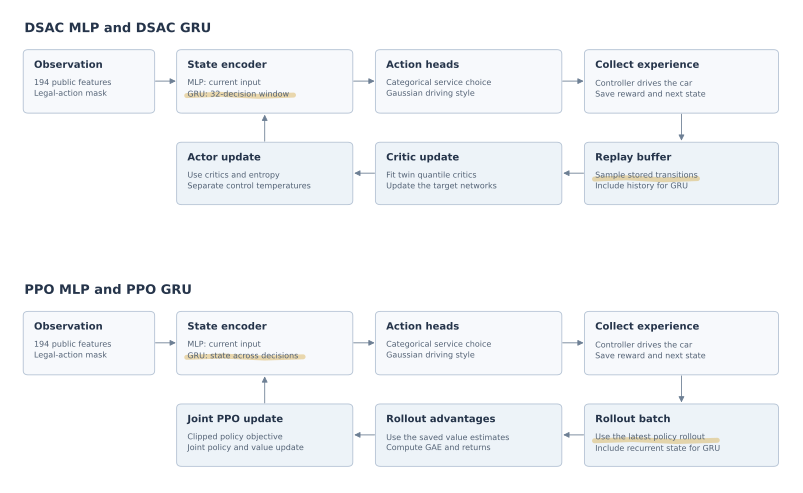
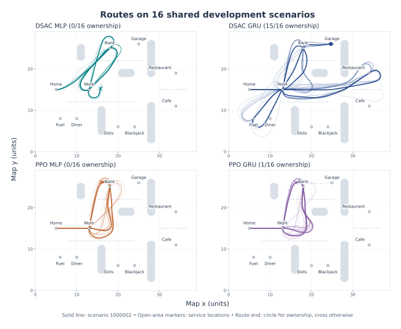

# Gambler’s Taxi — Skill transfer in a resource-constrained driving task

Iuliia Kurnaeva  
23 November 2026

## Abstract

Gambler’s Taxi combines continuous vehicle dynamics with discrete decisions about work, meals, sleep, fuel, borrowing and gambling. The agent must stay alive and close two kinds of debt to acquire the vehicle. We used a common curriculum to compare feedforward and recurrent variants of hybrid distributional SAC and PPO. Only DSAC GRU met the development readiness threshold, achieving ownership in 60 of 64 sampled development episodes. A standalone evaluation of that checkpoint completed 30 registered conditions and yielded 239 of 256 standard test buyouts. Repeated probes found that both PPO policies retained an isolated food skill even though they rarely used it in the full campaign. This contrast motivates an evaluation protocol that measures prerequisite competence and transfer separately. [Study record](study/README.md)

## Task and method

The simulator joins a continuous bicycle model and lidar sensor to a city economy. The learner sees public resources, liabilities, time and services. Demand, prices and outcomes vary by seeded scenario. A shared driver executes chosen destinations and continuous style controls. Travel exposes the same resource and traffic costs for all policy variants. JAX batches 64 environments, and multi-tick decisions use duration-aware continuation discounts. [Environment](study/environment.md) and [training](study/training.md)

The original cohort used 14 sequential reset lessons, mixed earlier contexts where available and capped training at 262,144 decisions per policy. The standard development task used $500 car principal and a ten-day deadline. Training scenario IDs and development IDs were disjoint. Some development IDs also informed gates and checkpoint selection. The planned final suite has its own banks. [Run history](study/experiments.md) and [frozen conditions](study/data/frozen_conditions.csv)

## Results

| Selected policy | Development ownership | Lessons passed |
|---|---:|---:|
| DSAC MLP | 0/64 | 3/14 |
| DSAC GRU | 60/64 | 14/14 |
| PPO MLP | 8/64 | 12/14 |
| PPO GRU | 3/64 | 12/14 |

A repeated deterministic evaluation of DSAC GRU yielded 59/64. Under sampled inference it performed 102 meals and 108 refills in 64 episodes, alongside 223 paid shifts. It took one new loan and placed no wagers on this bank. The main cohort supplies development evidence for resource management. Early casino clips and later recovery trials use other configurations. [Full outcomes and diagnostics](study/results.md)

The clearest contrast came from the matched PPO food probe. Both variants finished 16/16 episodes from the same food-approach context at every saved probe checkpoint, including the last. Full-campaign trajectories still showed rare food purchases, sometimes after cash had been committed to debt. A stacked DSAC MLP variant separately managed 16/16 in a garage-side ownership lesson while failing all 16 standard episodes. These observations show a gap between acquiring a local interaction and composing it with travel, survival and debt payment. They leave open whether other earlier contexts showed training-induced forgetting, and whether recurrent history or replay coverage drove DSAC GRU’s result. [Transfer and failures](study/transfer.md)

The final evaluation showed a steep debt response. The frozen policy completed 239/256 ownership outcomes at $500, 11/256 at $1,000 and 0/256 at $1,500 on the same scenario IDs. All 11 $1,000 successes relied on wages and starting cash. No wager was requested or taken in the 7,680 final episodes. Nearly empty fuel and the joint stress condition both yielded 0/256 ownership. The audit found the earlier delayed-failure reward incentive and verified the base reward correction. It found no confirmed reward-hacking episode in the final evaluation. [Final scenario analysis](study/final_dsac_gru.md) and [problems and fixes](study/problems_and_fixes.md)

## Contribution and limits

The project provides a reproducible simulator and matched episode records for examining whether policies learned under staged starts can compose their skills under a deadline. The route and resource traces can help locate points where a policy depletes cash or time despite holding a useful local skill. This evaluation pattern applies to simulated scheduling and resource-allocation problems with similar constraints. Human gambling behavior would require separate evidence, as would a comparative claim about the effects of recurrence or replay.

The four models used one training initialization each and stopped at different lesson caps. The final suite provides held-out scenario results for one DSAC GRU checkpoint. Algorithm-level claims require final results for comparable policies across independent training runs. [Experiment matrix and status](study/experiments.md)

## Artifacts

[Reproduction commands](study/reproduce.md), [four checkpoints](study/checkpoints/manifest.json), [data index](study/data/README.md), [figures and replays](study/media.md) and [Assignment 1 and 2 reports](study/README.md)
