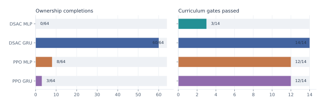

# Gambler's Taxi research record

| Open | Contents |
|---|---|
| [Assignment 1](../assignment1.md) and [Assignment 2](../assignment2.md) | Environment and learning reports |
| [Research report](../research.md) | Methods, findings and limitations |
| [Environment](environment.md) | Vehicle dynamics, observation, services, debt accounting and reward |
| [Training](training.md) | Four architectures, curriculum, optimizer and validation design |
| [Experiment history](experiments.md) | Completed runs, revisions, failures, planned conditions and original files |
| [Results](results.md) | Measured outcomes, denominators and status by policy and study |
| [DSAC GRU final evaluation](final_dsac_gru.md) | Follow-up on the 30 frozen test conditions |
| [Problems and fixes](problems_and_fixes.md) | Reward design, food planning, interface faults and recovery checks |
| [Transfer and failure analysis](transfer.md) | Matched food-retention results, PPO and DSAC failure modes, scope of the forgetting hypothesis |
| [Media library](../../media/README.md) | All 19 distinct videos, images and figures |
| [Figure notes and replay data](media.md) | Scientific figure captions, the four assignment clips and their replay inputs |
| [Reproduction](reproduce.md) | Frozen source, portable checkpoints, commands and expected results |
| [Data index](data/README.md) | Compact result tables and complete local inventory |

**The headline result is 60/64 development ownership completions for DSAC GRU under sampled inference.** A deterministic recheck produced 59/64 on the same development bank. The other three original policies fell below readiness. The [30-condition DSAC GRU evaluation](final_dsac_gru.md) recorded 239/256 standard test buyouts and 11/256 at $1,000.

[Published artifact inventory](data/local_file_index.csv)
