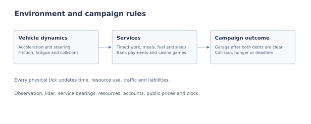

# Environment and reward

## Physical interface

[ResourceTaxiEnv](../../src/env/resource_taxi.py) inherits from the course [BaseEnv](../../src/env/base.py). It implements initialization, reset, step and observations in JAX. The [city map](../../src/env/city.py) is 40 × 30, with ten service locations, static unit circles and three moving unit circles. Swept collision uses the sum of obstacle and vehicle radii. The shared driver navigates to the policy's chosen destination. It does not choose a service.

A kinematic bicycle model permits a finite turning radius and interpretable braking without requiring a tire model. Acceleration/braking and target steering are normalized to [−1, 1]. The integration time step is 0.16, wheelbase 0.8, steering limit 0.58 radians and maximum powered speed 3.8 map units per unit time. Traction is 2.9 times positive acceleration. Braking gain is 5.1 and attenuates with fatigue. Steering approaches its target with a fatigue-dependent response. Positive-speed drag is `0.22 + 0.055 v²`. The update uses mean speed and midpoint heading. Empty fuel limits driving to voluntary pushing at speed 0.2, with extra hunger and fatigue cost. Zero satiety terminates the episode.

An observation combines lidar, relative service positions and obstacle-aware static distances, speed and steering, funds, both debt totals, fuel, satiety, fatigue, time and public prices. The public food menu adds portion ranges and service times. Lidar captures local obstacles and traffic. Future market and casino draws are absent from the inputs. The state and observation remain distinct, and the policy observes many but not all variables in the mechanics.

## Economy and termination

The general environment default is $1,000 car principal. The completed ownership study used $500 principal, $100 living cash and a ten-day deadline. The clock advances in physical ticks, with 155 ticks per simulated day. Work requires an eligible shift window and uses fuel. Sleep uses time and restores fatigue. Parking gates the physical service through an arrival radius of 1.55 and speed below 0.2. Meals charge the price before service and restore satiety on completion.

| Service | Quote range before scenario modifiers | Raw satiety gain | Physical ticks |
|---|---:|---:|---:|
| Budget diner | $4–6 | 0.04–0.06 | 2 |
| Cafe | $12–18 | 0.12–0.18 | 5 |
| Restaurant | $30–40 | 0.55–0.75 | 10 |

The car installment ledger and individual personal loans are separate. Borrowing raises cash and liabilities by the borrowed principal. Interest and scheduled shortfall fees cost wealth. Ownership requires both debt balances to reach zero and a subsequent garage interaction. Finite episodes end in ownership, collision, starvation or deadline. Continuing scenarios have administrative censoring in evaluation. Service costs, dynamic prices and gambling draws are part of the simulator. Standard slots and blackjack have negative expected monetary return under their implemented rules. [Analytical calculations](data/diagnostics/analytic_checks.json)

## Reward choice

The base external reward gives +1 on ownership, plus up to 0.05 for closing cash. An unsuccessful terminal yields −0.1. Each nonterminal physical tick incurs `−0.1 × (1−γ)`. At `γ = 0.999`, discounted base return for a finite unsuccessful episode is −0.1 regardless of its duration. Among otherwise equivalent wins, earlier ownership is preferred. This removed a calibration incentive to postpone failure without making progress.

An optional secondary external reward adds the change in bounded net-worth utility, `U(W) = 0.1 clip(W/2000, −1, 1)`. Net worth includes outstanding liabilities, so issuing a new loan does not create reward by itself. Purchase costs count immediately and the value of survival emerges later in a trajectory. Optional potential shaping is a separate term `γΦ(s′)−Φ(s)`. The completed ownership cohort used the net-worth term and disabled potential shaping and targeted navigation cues. [Frozen config](data/cohort/dsac_gru/evaluation.json) and [Reward audit](../reward_audit.md)

[Environment verification record](data/diagnostics/environment_verification.json), [Original course starter](https://github.com/InnoRL/IAEML-assignment) and [Recorded environment demonstration](../../media/video/environment-demonstration.mp4)
