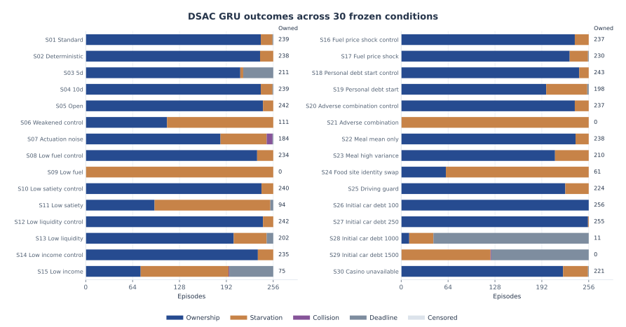

# DSAC GRU final scenario evaluation

The selected DSAC GRU completed **30 registered conditions and 7,680 episodes**. The evaluation used the checkpoint's recorded configuration and 256 episodes per condition on the registered final scenario banks. Conditions reused IDs for matched comparisons. S02 used deterministic inference. All 30 conditions replayed with zero logged float error across 4,976,191 active physical ticks. Endpoints show zero outstanding car or personal debt in every ownership outcome. [Run manifest](data/final_dsac_gru/manifest.json), [summary CSV](data/final_dsac_gru/summary.csv) and [audit receipt](data/final_dsac_gru/audit_summary.json)

## Main results

Standard ownership was **239/256 (93.4%)**, with a 95% Wilson interval of **89.6–95.8%**. Initial debt of $1,000 reduced ownership to **11/256 (4.3%)** on the same scenario IDs, with a 95% Wilson interval of **2.4–7.5%**. The $1,500 condition recorded 0/256. The interval describes scenario-sample uncertainty for this checkpoint. The study has one training initialization for this policy. [Standard uncertainty](data/final_dsac_gru/S01/uncertainty.json) and [$1,000 uncertainty](data/final_dsac_gru/S28/uncertainty.json)

## All 30 conditions

Each row uses 256 episodes. The match for an adverse condition is its own control. The standard condition is the match for the remaining interventions. No episodes reached the 30-day administrative censoring threshold.

| ID | Condition | Ownership | Starvation | Collision | Deadline |
|---|---|---:|---:|---:|---:|
| [S01](data/final_dsac_gru/S01/evaluation.json) | Standard | 239/256 | 16 | 0 | 1 |
| [S02](data/final_dsac_gru/S02/evaluation.json) | Deterministic inference | 238/256 | 18 | 0 | 0 |
| [S03](data/final_dsac_gru/S03/evaluation.json) | Five days | 211/256 | 4 | 0 | 41 |
| [S04](data/final_dsac_gru/S04/evaluation.json) | Ten days | 239/256 | 16 | 0 | 1 |
| [S05](data/final_dsac_gru/S05/evaluation.json) | No deadline | 242/256 | 14 | 0 | 0 |
| [S06](data/final_dsac_gru/S06/evaluation.json) | Weakened control | 111/256 | 145 | 0 | 0 |
| [S07](data/final_dsac_gru/S07/evaluation.json) | Actuation noise | 184/256 | 63 | 8 | 1 |
| [S08](data/final_dsac_gru/S08/evaluation.json) | Low fuel control | 234/256 | 22 | 0 | 0 |
| [S09](data/final_dsac_gru/S09/evaluation.json) | Low fuel | 0/256 | 256 | 0 | 0 |
| [S10](data/final_dsac_gru/S10/evaluation.json) | Low satiety control | 240/256 | 16 | 0 | 0 |
| [S11](data/final_dsac_gru/S11/evaluation.json) | Low satiety | 94/256 | 158 | 0 | 4 |
| [S12](data/final_dsac_gru/S12/evaluation.json) | Low cash control | 242/256 | 14 | 0 | 0 |
| [S13](data/final_dsac_gru/S13/evaluation.json) | Low cash | 202/256 | 45 | 0 | 9 |
| [S14](data/final_dsac_gru/S14/evaluation.json) | Low income control | 235/256 | 21 | 0 | 0 |
| [S15](data/final_dsac_gru/S15/evaluation.json) | Low income | 75/256 | 120 | 1 | 60 |
| [S16](data/final_dsac_gru/S16/evaluation.json) | Fuel price control | 237/256 | 19 | 0 | 0 |
| [S17](data/final_dsac_gru/S17/evaluation.json) | Double fuel price | 230/256 | 25 | 0 | 1 |
| [S18](data/final_dsac_gru/S18/evaluation.json) | Personal debt control | 243/256 | 13 | 0 | 0 |
| [S19](data/final_dsac_gru/S19/evaluation.json) | Personal debt at start | 198/256 | 56 | 0 | 2 |
| [S20](data/final_dsac_gru/S20/evaluation.json) | Combined stress control | 237/256 | 19 | 0 | 0 |
| [S21](data/final_dsac_gru/S21/evaluation.json) | Combined stress | 0/256 | 256 | 0 | 0 |
| [S22](data/final_dsac_gru/S22/evaluation.json) | Mean meal portions | 238/256 | 18 | 0 | 0 |
| [S23](data/final_dsac_gru/S23/evaluation.json) | Higher meal variance | 210/256 | 46 | 0 | 0 |
| [S24](data/final_dsac_gru/S24/evaluation.json) | Cafe and restaurant swapped | 61/256 | 195 | 0 | 0 |
| [S25](data/final_dsac_gru/S25/evaluation.json) | Longer driving guard | 224/256 | 32 | 0 | 0 |
| [S26](data/final_dsac_gru/S26/evaluation.json) | $100 car debt | 256/256 | 0 | 0 | 0 |
| [S27](data/final_dsac_gru/S27/evaluation.json) | $250 car debt | 255/256 | 1 | 0 | 0 |
| [S28](data/final_dsac_gru/S28/evaluation.json) | $1,000 car debt | 11/256 | 33 | 0 | 212 |
| [S29](data/final_dsac_gru/S29/evaluation.json) | $1,500 car debt | 0/256 | 122 | 1 | 133 |
| [S30](data/final_dsac_gru/S30/evaluation.json) | Casino unavailable | 221/256 | 34 | 0 | 1 |

## What stood out

Frozen-policy interventions show how behavior changes when the environment or policy inputs change. The archived training probes inspect actor probabilities and critic scores on matched inputs.

### Location bias after the menu swap

Exchanging the menus between the fixed cafe and restaurant sites reduced ownership from **239/256 to 61/256** and raised total meals from **402 to 1,110**. Scenario **3000057** shows how this happened. The driver took two meals at the restaurant site and bought out at tick 755 under the standard menu. After the swap it returned to the *same site* for all 16 meals, each restoring only **0.12–0.18** of the satiety scale before consumption. The two original portions were **0.63 and 0.74**. It starved at tick 1410. The repeated destination is consistent with a learned location preference that did not adjust to the new portions. [Meal events for 3000057](data/final_dsac_gru/s24_paired_meals_3000057.csv) and [suite action counts](data/final_dsac_gru/behavior.csv)

### Refueling omitted at low fuel

With one unit of fuel at reset, the driver completed exactly one shift in each of 256 episodes and chose neither refuel action. The policy requested the restaurant 72 times across those episodes, with zero completed meals. Every episode ended in starvation. Doubling fuel prices still yielded **230/256** ownership against **237/256** on its own matched bank. In the combined stress case the restaurant was requested 226 times, with zero completed meals, shifts or refuels. These logs distinguish omitting a resource action from choosing an action that fails to deliver its service. [Failure decision counts](data/final_dsac_gru/failure_choices.json) and [matched outcomes](data/final_dsac_gru/paired_ownership.csv)

### Sensitivity to the route controller

The longer driving guard changed ownership from **239/256 to 224/256**. There were zero collisions under either setting. On the shared IDs, the intervention rescued 13 standard failures and turned 28 standard successes into starvation. For example, scenario **3000007** went from starvation at tick 766 to ownership at tick 916. Scenario **3000001** went from ownership at tick 945 to starvation at tick 583. The intervention changed route-controller behavior and the resulting campaign states. These outcomes leave the relative importance of travel time, resource use and subsequent choices open. [Matched outcomes](data/final_dsac_gru/paired_ownership.csv) and [guard endpoints](data/final_dsac_gru/S25/endpoints.npz)

### Deadline sensitivity before the deadline

Removing the ten-day deadline changed ownership for five matched scenarios. Four standard failures became successes and one standard success became a failure. In **3000083**, the open campaign ended in ownership at tick 757, while the standard campaign starved at tick 765. In **3000104**, the open campaign starved at tick 753 and the standard campaign bought out at tick 903. The ten-day deadline was tick 1550, so neither reversal came from clipping the same trajectory at that deadline. The intervention changed decisions or execution earlier in the episode. [Standard endpoints](data/final_dsac_gru/S01/endpoints.npz), [open-campaign endpoints](data/final_dsac_gru/S05/endpoints.npz) and [matched outcomes](data/final_dsac_gru/paired_ownership.csv)

### Action repetition at $1,500 debt

In S29 the policy chose the restaurant **57,534 times**, including **53,627** intentions that lasted a single physical tick. It never chose a car payment. A payment intention was allowed by the policy mask on **64,507 of 64,534** decisions and at least once in every episode. Mask eligibility permits the intention, while the physical payment still requires reaching the bank. Scenario **3000189** alone had 574 restaurant requests, 559 lasting one tick, and only 15 completed meals before starvation. The decision log shows repeated selection and short feedback, with zero performed car payments. It leaves open why the actor kept choosing the restaurant and whether an alternative would have cleared the debt. [Per-episode decision counts](data/final_dsac_gru/s29_action_loop.csv) and [condition audit](data/final_dsac_gru/S29/audit.json)

### How the $1,000 buyouts happened

All 11 successful episodes paid from wages and the original $100. They completed **five to eight shifts**, spent on meals and fuel, and incurred $20 in late fees before making a sequence of bank payments. They completed zero sleeps and opened zero new personal loans. Cash and actual debt payments reconcile for each winner. [Eleven reconciled ledgers](data/final_dsac_gru/s28_buyouts.csv) and [transactions in tick order](data/final_dsac_gru/s28_buyout_events.csv)

The market pays **$131.25, $175.00 or $236.25** for a shift, with probabilities 30%, 40% and 30%. On scenario **3000063**, all five paid shifts paid the top rate. The agent earned **$1,181.25** in shifts on days 1, 3, 4, 5 and 7. It spent **$106.58 on food** and **$17.99 on fuel**. It made ten $100 bank payments starting at tick 1051, followed by a final $55.08 payment. The $1,055.08 paid included $35.08 in interest and $20 in late fees. It cleared the balance at tick 1081, reached the garage at tick 1114 on day 8, and kept **$101.60**. [Scenario replay](../../media/video/dsac-gru-debt-1000-3000063.mp4) and [event log](../../media/video/dsac-gru-debt-1000-3000063.events.json)

Holding each winning trace's work count and recorded expenses fixed, replacing the realized wages with $175 per shift makes **8 of 11** final cash balances negative. Replacing them with the market expectation of $180.25 leaves **5 of 11** negative. The five-shift example would be $204.65 short at the flat base wage. This is an accounting substitution on recorded behavior. The policy's response to a different wage process would require a separate evaluation.

### Gambling and the casino closure

The final policy selected **zero wager intentions** and initiated **zero slot spins and zero blackjack hands** across all 7,680 episodes. It took **145 new personal loans in 142 episodes**. Two stress conditions also assigned 512 inherited loans at reset, counted separately. Consequently the final run contains no events from which to estimate loss chasing. [Final action counts](data/final_dsac_gru/behavior.csv)

With gambling disabled, the frozen actor achieved **221/256**, compared with **239/256** on the same standard IDs. The intervention changes the legal-action mask, which the actor receives as an input. On the matched starts, 23 standard successes became failures and five standard failures became successes. At the first decision, the 256 observation vectors were identical and the masks differed for all 256 starts. Both variants selected Wait in every start, with zero applied control, but the raw continuous samples differed in all 256 pairs. The mask is part of the network input. This is direct evidence of a change upstream of the applied action, while the later outcome change can include multiple downstream decisions. This comparison measures a change in simulator configuration for the frozen network. Its observed effect cannot be assigned to money made gambling. [First-decision comparison](data/final_dsac_gru/s30_first_decision.json), [matched outcomes](data/final_dsac_gru/paired_ownership.csv) and [frozen source](checkpoints/frozen_source.zip)

### Voluntary repeat wagers in the prototype

The earlier destination-policy study contains voluntary bets. For example, on shared start 91010, two mixed-demo policies each lost $55, chose to wager again and then gained $270. Both agents repeated a bet after a loss. One ultimately bought out and the other got stuck on the route home. The historical matched loss-versus-win probes did not find a consistent loss-specific effect across seeds. The earlier destination policies used demonstrations and different mechanics. [Historical gambling and loss-versus-win probes](../../baseline/reports/debt_research.md#53-voluntary-continuation-and-loss-specific-response)

### Actor–critic disagreement in a food probe

In a separate archived DSAC MLP probe, the critics ranked the restaurant first in all 16 saved hunger states. The actor assigned it probability about **8 × 10⁻¹⁰**. This compares the two model outputs on the same recorded inputs. The follow-up fixed-critic gradient test explains how the actor update could leave such a low-probability action suppressed even when the critic ranked it high. The critic score is a prediction, and the probe covers those 16 states. In a separate PPO probe, both late checkpoints still completed **16/16** isolated food-approach cases, despite nearly omitting food in the campaign. These diagnostics distinguish disagreement between model components from a skill that fails to transfer across contexts. [Actor–critic probe](../local_food_recovery/ACTOR_DIAGNOSIS.md) and [PPO transfer checks](transfer.md)

### Reward hacking

The final replay and financial checks found **no confirmed reward-hacking episode**. Every ownership endpoint had both debts cleared. All 11 $1,000 cash ledgers reconcile using wages, purchases and payments. The confirmed **reward specification loophole** was in an earlier calibration: the discounted old objective made a late failure score better than an otherwise comparable early failure. The evidence is the return calculation. It establishes an incentive for stalling, while whether any given policy used that incentive requires trajectory evidence. The [results record](results.md#reward-hacking-and-suspicious-behavior) explains the correction and separates that finding from unproductive action loops. See the [problems and fixes](problems_and_fixes.md) for what changed and which checks passed.

## Files and reproduction

[Per-condition endpoints and receipts](data/final_dsac_gru/), [condition register](data/frozen_conditions.csv), [checkpoint manifest](checkpoints/manifest.json) and [reproduction](reproduce.md). Run `python reports/analyze_final_dsac_gru.py` to rebuild the tables from the trajectories in `artifacts/dsac_gru_final/`.
