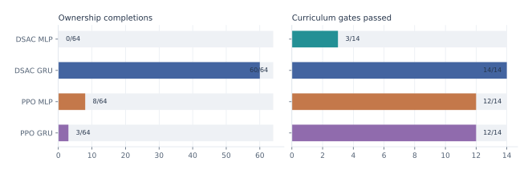

# Recorded results

## Completed ownership cohort

Sampled selected-policy evaluation on standard $500 development scenarios 1000001–1000064.

| Policy | Ownership | Starvation | Lessons passed | Training decisions | Physical ticks |
|---|---:|---:|---:|---:|---:|
| DSAC MLP | 0/64 | 64 | 3/14 | 79,872 | 1,943,043 |
| DSAC GRU | 60/64 | 4 | 14/14 | 262,144 | 8,220,846 |
| PPO MLP | 8/64 | 56 | 12/14 | 151,552 | 6,431,870 |
| PPO GRU | 3/64 | 61 | 12/14 | 139,264 | 6,356,600 |

DSAC GRU also scored 59/64 in two bitwise-identical deterministic checks on the same development bank. Its original run performed 223 paid shifts, 102 meals, 108 refills and 375 car payments in the 64 sampled episodes. It opened one new personal loan and completed no slots, blackjack or sleep actions in those episodes. In separate retained development contexts, it completed ownership 16/16 for earning, 13/16 for food approach, 16/16 for fuel and 16/16 for personal debt. These are descriptive results from one initialization and a reused development bank.

[Machine-readable table](data/development_summary.csv), [Per-episode arrays and logs](data/cohort/) and [Original audit and retained outcomes](../resource_study_review_2026-11-23/review.md)

## Recovery and integration results

| Check | Observed result |
|---|---|
| DSAC MLP forward-KL continuation, legacy observation | 16/16 in near-restaurant prerequisite; 11/16 for food approach and 11/16 for food from home. 0/16 standard, with 93 meals, zero refills and 13 endpoints at zero fuel. Terminal causes: 15 starvation, one collision. |
| DSAC MLP fixed-temperature KL switch, original observation | 0/16 standard, one refill per episode, no meals, 16 starvation. |
| DSAC MLP two frames + adaptive discrete temperature, 5,000 updates | 16/16 ownership-only lesson, 0/16 food prerequisite despite 2.25 meals per episode, and 0/16 on standard campaign with no completed meals. All 16 standard episodes starved. |
| PPO MLP and PPO GRU final-stage stress test | Both 0/16 before and after 16,384 decisions. Both had 16 starvation outcomes at the end. Maximum explained variance at 8k–10k was 0.401 and 0.521. KL stopping was exercised. |
| Observation and reset checks | 32/32 fitted action labels in a supervised wiring check; 28/100 standard-home resets in a rehearsal check; two identical deterministic GRU evaluations. |

[Completed local continuations](data/recovery_trials/), [Smoke outputs and optimizer diagnostics](data/smoke/) and [Paired inference modes on 16 scenarios](data/diagnostics/inference_modes.json)

## Final evaluation

The frozen DSAC GRU completed **30/30 conditions** and passed all replay audits. Standard ownership was **239/256**, compared with **11/256** at $1,000 debt and **0/256** at $1,500. All $1,000 buyouts came from wages and starting cash. No wagers were requested or started across the 7,680 episodes. [All final conditions](final_dsac_gru.md#all-30-conditions), [case analysis](final_dsac_gru.md#what-stood-out), [$1,000 ledgers](data/final_dsac_gru/s28_buyouts.csv) and [action counts](data/final_dsac_gru/behavior.csv)

## Reward hacking and suspicious behavior

| Finding | Evidence and correction |
|---|---|
| **Confirmed design loophole in the early reward** | The previous calibration discounted a large terminal penalty enough to reward postponing failure relative to failing sooner. I set the final penalty and time cost so all finite failures have the same discounted base return of −0.1. The declared wealth term is separate. [Reward derivation](../reward_audit.md). |
| **Quick wins in a short prototype** | Favorable slot payouts could settle the early campaign before other mechanics mattered. Those were outcomes allowed by the old economy. The cooldown, hours, longer horizon and settlement requirement reduced this shortcut. [Original design reflection](../../baseline/reports/assignment1.md). |
| **Observed failed-service and credit loops** | One DSAC MLP checkpoint repeated 3,904 one-tick failed work requests and another repeatedly requested borrowing and repayment. The logs show poor control and cash use. [Failed-policy diagnosis](../resource_study_review_2026-11-23/food_diagnosis/findings.md). |
| **Final DSAC GRU** | No reward-hacking episode confirmed by the financial and execution checks. The debt-free requirement holds for every ownership outcome and cash balances reconcile in all 11 $1,000 winners. [Audit summary](data/final_dsac_gru/audit_summary.json) and [final trace analysis](final_dsac_gru.md). |

[Problems, fixes and verification](problems_and_fixes.md)
