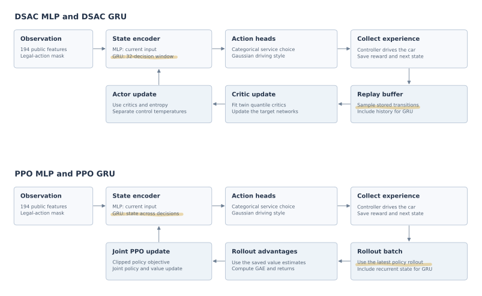
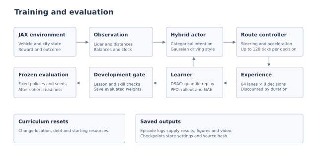
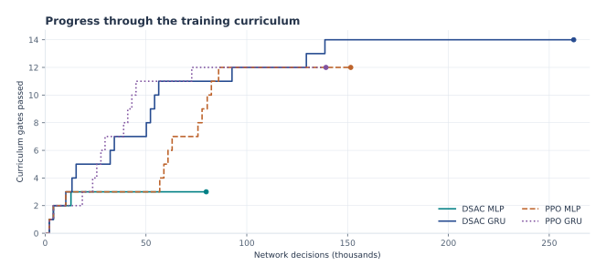
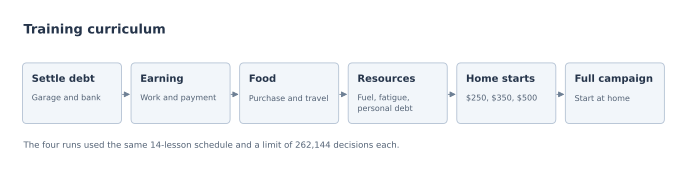

# Learning architecture and execution

The actor selects a categorical service intention and a continuous squashed-Gaussian driving style. The shared route controller executes the selected intention under the vehicle dynamics. There are 26 service alternatives, including Wait, fixed-amount loans and wagers, and blackjack hit and stand. Each decision executes at most one service. A completed ownership-study intention lasts up to 128 physical ticks and can yield after arrival, settlement, a refusal or termination. We sum discounted rewards within the intention and carry forward `γ^duration` at the next decision. [Service interface](../../src/strategy.py)

## Observed and planned configurations

| Item | Ownership cohort | Tuned configuration |
|---|---|---|
| Observation | 194 features with previous intention | 370 for stacked MLP, 198 for PPO GRU, original 194 for frozen DSAC GRU |
| Reset curriculum | 14 lessons, 20% earlier-context rehearsal when available | 18 lessons, 25% standard home resets starting at lesson 5 |
| Budget | 262,144 decisions per model ceiling | Same ceiling, 102,400 reserved for late lessons |
| Hybrid DSAC | Twin 24-quantile critics, replay, fixed temperatures and reverse KL | Forward to reverse KL for new MLP, frozen GRU retained |
| PPO | PPO clipping 0.2, GAE 0.95, three epochs | Native sampling, up to 12 epochs, clipping 0.15, KL early stop, scaled value loss |
| Evaluations | One qualified policy and three failures at curriculum gates | Integration tests and short development runs |

The completed run captured 64 environments × 8 decisions per collection. DSAC samples replay, updates twin critic distributions with quantile Huber regression, and uses target networks. The standard actor weights the critic distribution by its mean. This study did not fit a CVaR policy. DSAC GRU encodes a rolling 32-decision history, with separate recurrent paths for actor and critic in the completed cohort. PPO uses a clipped likelihood ratio and GAE from fresh rollouts. Its GRU carries recurrent state across decisions and resets on episode termination. [Frozen run settings](data/cohort/dsac_gru/config.json) and [Frozen source](checkpoints/frozen_source.zip)

Each step marks a passed curriculum gate. The dots mark the end of each run, including further training by DSAC GRU after passing the last gate. [Training and gate logs](data/cohort/)

## Original model settings

The feedforward heads use width 128. DSAC GRU encodes the most recent 32 observations with a width-128 GRU, concatenates the current observation to its encoded history, and uses separate encoders for actor and critic. PPO GRU applies a width-128 GRU after its feedforward trunk. PPO feeds the recurrent state into a joint action-and-value head and trains the policy and scalar value terms with one optimizer update per minibatch. Both algorithms mask illegal service choices.

The original DSAC actor learning rate was 0.0001 and the critic learning rate was 0.0003. A collection was followed by 64 gradient updates with replay minibatches of 128. Target weights use a soft update rate of 0.005. Discrete and continuous entropy coefficients were both fixed at 0.000003. PPO ran three epochs on each new rollout, using GAE with λ = 0.95 and a ratio clip of 0.2. [Frozen source and runner](checkpoints/frozen_source.zip)

## Curriculum and scenario splits

Early lessons change only the reset context. They start with closure and work, then exercise eating, refueling and debt settlement. Later lessons raise home-start principal to $500. Original gates measured performance on scenarios 1000001–1000016, with a separate standard development bank of 64 overlapping development scenarios used to select checkpoints. The four configurations used initialization seed 301 and training scenario IDs 11–10010. The standard final bank reserves IDs 3000001–3000256. Each adverse bank contains 256 scenarios and a paired control. The final suite was protected behind a cohort gate. Later revisions required retained-skill checks and tied readiness to the exported checkpoint. [Registry](data/cohort/freeze.json) and [Corrected protocol notes](../resource_study_review_2026-11-23/recovery_status.md)

## Computation and provenance

- JAX compiles the dynamics and updates. `vmap` batches lanes and `lax.scan` implements time loops. Static road-distance fields are reused. Checkpoints, not constant policy weights embedded in a rendering loop, feed evaluation.
- The GPU trains and evaluates headlessly. Telemetry stores per-tick cash, debt, service events and applied controls. Rendering reads numeric traces after the run.

Algorithm references: [Hybrid SAC](https://arxiv.org/abs/1912.11077), [Distributional SAC](https://arxiv.org/abs/2004.14547), [PPO](https://arxiv.org/abs/1707.06347), and [Quantile regression for distributional RL](https://arxiv.org/abs/1710.10044).
