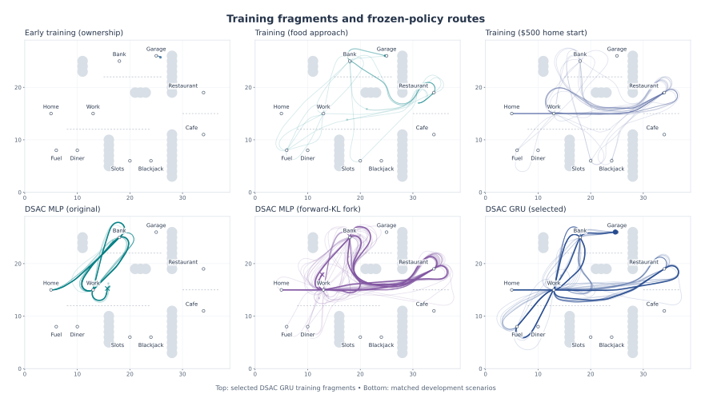

# Transfer, retention and failure analysis

## What the matched retention probes show

Both PPO variants completed 16/16 ownership episodes with food on the same food-approach reset at four saved checkpoints, including their last failed checkpoint. In the full standard campaign the same model families almost never requested food. This is direct evidence of poor transfer from an isolated context to the full planning chain. A complete erasure of the narrow purchase skill would contradict the matched-checkpoint result. A more specific forgetting hypothesis could still apply to decisions in other contexts. [Matched checkpoint data](data/diagnostics/food_retention.json) and [Original diagnostic](../resource_study_review_2026-11-23/food_retention/findings.md)

The original DSAC MLP failed the first food prerequisite. Later forward-KL recovery acquired that local skill, then failed the full campaign. The stacked KL-switch follow-up succeeded at immediate ownership when the reset put the agent near the garage with its debt already settled. This shows that the network and objective can represent the local action sequence. It cannot certify long-horizon learning or prove that a previously acquired skill was erased. The same stacked checkpoint still completed 2.25 meals per episode in a food prerequisite and zero in its standard campaign. [Stacked DSAC test](data/smoke/test2_stacked.json)

## Other mechanisms observed in the logs

- **Liquidity and timing.** Failed PPO trajectories often paid debt with cash needed for living costs. Some late food requests occurred with insufficient time or money. The two PPO models completed zero and one meal respectively over their original 64 standard episodes. [Decision evidence](data/diagnostics/decisions.csv)
- **Actor saturation.** On 16 saved hunger states after a local DSAC MLP continuation, a critic ranked the restaurant first while the actor assigned it probability around 8×10⁻¹⁰. A forward-KL projection materially increased the action-logit gradient in those same states. Later campaign failures involved fuel and loan management. [Critic values](data/diagnostics/critic_estimates.json) and [Gradient check](data/diagnostics/actor_projection_check.json)
- **Exploration and budget.** Measured PPO training choices can include food generated by external exploration even when the underlying actor almost always refuses it. The native-sampling update corrected this mismatch of signals in a separate treatment. It did not learn the complete campaign in the short stress test. [PPO probabilities](data/diagnostics/ppo_food_probabilities.json) and [PPO diagnosis](../local_food_recovery/PPO_DIAGNOSIS.md)
- **Replay coverage and memory.** The original DSAC curriculum retained its replay across lesson changes and mixed earlier reset contexts. A finite replay buffer can still evict early transitions, and the logs do not identify the exact composition of each minibatch. Successful GRU behavior is consistent with a useful history representation, but architecture, acquired experience and actual training length differed in the available outcomes. [Frozen source](checkpoints/frozen_source.zip)

A direct forgetting test would follow fixed policy snapshots through training and evaluate them on identical earlier contexts at every transition. An improvement or decline would then be compared across independently seeded variants that vary history, reset rehearsal and replay composition separately. This distinguishes retention from distribution shift and from failure to learn the skill initially. [Kirkpatrick et al., PNAS](https://pmc.ncbi.nlm.nih.gov/articles/PMC5380101/) and [Kaplanis et al., ICML](https://proceedings.mlr.press/v97/kaplanis19a.html)

The final policy also failed to adapt to a low-fuel start. It completed one shift in every episode but requested neither refuel action, despite refueling in the standard condition. In the combined stress case it requested the restaurant repeatedly but completed no meal. Those two conditions each ended in 256 starvation outcomes. These results identify a missing action in one case and unsuccessful execution after a food decision in the other. [Final scenario analysis](final_dsac_gru.md) and [problems and fixes](problems_and_fixes.md).
